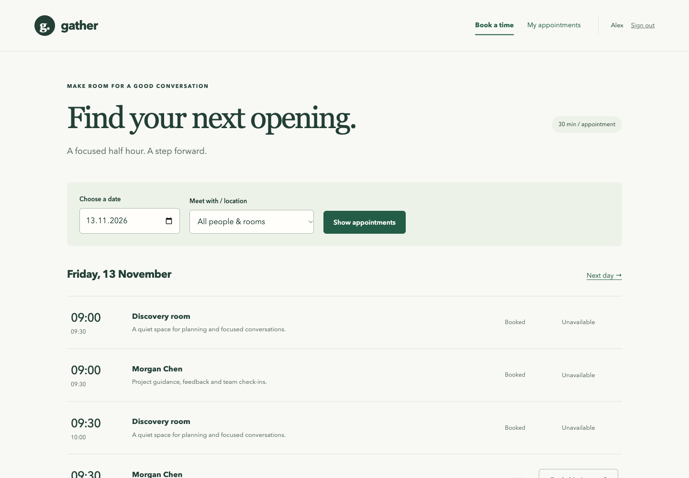

# Gather · A small Django appointment planner

A working management demo and a beginner-friendly Django learning project.
Book a 30-minute appointment, prevent double bookings, cancel your own booking,
and review the team's day. No frontend framework, no API layer, no paid services.



## Start in one command

Install **Python 3.12 or newer** (tested here with Python 3.14).
Download [the project-only ZIP](https://github.com/pyaichatbot/pocs/raw/refs/heads/main/appointment-demo/gather-starter.zip),
unzip it, and open a terminal inside `appointment-demo` (the folder containing `manage.py`).
Alternatively, use **Code → Download ZIP** on the repository and open its
`appointment-demo` subfolder.

**macOS / Linux**
```sh
python3 start.py
```

**Windows**
```powershell
py start.py
```

Open **http://127.0.0.1:8000**. The first run needs internet to install Django.
The launcher creates `.venv`, migrates the database, adds sample data, and starts
Django. Stop with **Ctrl+C**. Your bookings remain in your local `db.sqlite3`.

## Try the demo

| Account | Password | Role |
| --- | --- | --- |
| `alex` | `LearnDjango!2026` | Book and cancel appointments |
| `sam` | `LearnDjango!2026` | A second user, with sample bookings |
| `manager` | `LearnDjango!2026` | Book appointments and view Team overview |

These are local demo accounts. No real attendee data is included.
The seed command creates slots for today and the next six days, 09:00–17:00.
If today's appointments have passed, use **Next day**.
All displayed times use **Europe/Berlin**, including daylight saving time.
A confirmation is saved in the app; no email or external calendar invite is sent.

## Learn in this order

Read [the guided walkthrough](docs/LEARN.md), then rehearse
[the five-minute management demo](docs/DEMO.md).

| File | One job |
| --- | --- |
| `appointments/urls.py` | Map a path to a view |
| `appointments/views.py` | Coordinate a request and return a response |
| `appointments/forms.py` | Validate editable inputs |
| `appointments/models.py` | Describe data and booking rules |
| `templates/appointments/` | Display HTML |
| `appointments/middleware.py` | Log the real request/response boundary |
| `appointments/tests.py` | Check behavior and access rules |
| `config/settings.py` | Configure the application |

Files are kept below **200 lines**. Comments are short, placed beside the decision
they explain, and focus on *why*. Start with one view; you don't need to read everything.

## Manual setup (optional)

```sh
python3 -m venv .venv
source .venv/bin/activate
python -m pip install -r requirements.txt
python manage.py migrate
python manage.py seed_demo
python manage.py runserver
```

On Windows, use `py -m venv .venv`, then `.venv\Scripts\Activate.ps1`.
If PowerShell blocks activation, call `.venv\Scripts\python.exe` directly
in place of `python`; changing execution policy is unnecessary.

## Check the project

With the virtual environment activated:

```sh
python manage.py test
python manage.py check
python manage.py makemigrations --check --dry-run
```

Tests cover login, validation, database uniqueness, ownership, cancellation,
CSRF, escaping, filtering, redirects, overview access, tracing, and repeatable seeding.
To edit resources and slots in Django admin, create your own superuser:

```sh
python manage.py createsuperuser
```

Then visit `/admin/`. The demo manager can see the overview but has no admin model
permissions. Create slots on the hour or half hour; each lasts exactly 30 minutes.

## How this relates to your course

The supplied [Django Fundamentals course repository](https://github.com/codesensei-courses/django-4-fundamentals)
uses a meeting planner and covers models, views, templates, URLs, ModelForms, and
authentication. This is a separate implementation using the same core concepts.
It is not a clone or a drop-in replacement for the course files.

This project pins Django **5.2.19** from the 5.2 LTS line, rather than Django 4.
See [Django's release/support table](https://www.djangoproject.com/download/).
Use [the Django 5.2 tutorial](https://docs.djangoproject.com/en/5.2/intro/tutorial01/)
when looking up code for this project.

## Deliberate boundaries

- Fixed 30-minute slots; two sample resources; one office timezone.
- The database allows only one booking per slot. Slot management is via admin.
- Cancellation deletes a booking; there is no cancellation history or audit trail.
- SQLite suits this local demo. This has not been load-tested for concurrent traffic.
- No reminders, recurring meetings, calendar sync, self-registration, or password reset.
- The trace logs method, path, resolved view, status, and elapsed time. It does not
  claim to log every database query or every internal Django step.

## Before deploying publicly

This is a local demo, not a production deployment configuration. Replace the demo
accounts and secret key, disable DEBUG and tracing, configure allowed hosts, HTTPS,
secure cookies, a production server, database backups, and login rate limiting.
Review slot scheduling and concurrency for your real workload. Do not expose `runserver`.

## Troubleshooting

- **Port 8000 is busy:** `python manage.py runserver 8001`, then open port 8001.
- **No slots next week:** run `python manage.py seed_demo` to add the next seven days.
- **Wrong password after seeding:** existing passwords are intentionally preserved.
  Run `python manage.py changepassword alex`.
- **Install fails:** check internet/proxy settings and the Python version.
- **Start fresh:** stop the server, delete only `db.sqlite3`, then run `python start.py`.
  This deletes local users and bookings; do it only when you want a reset.
