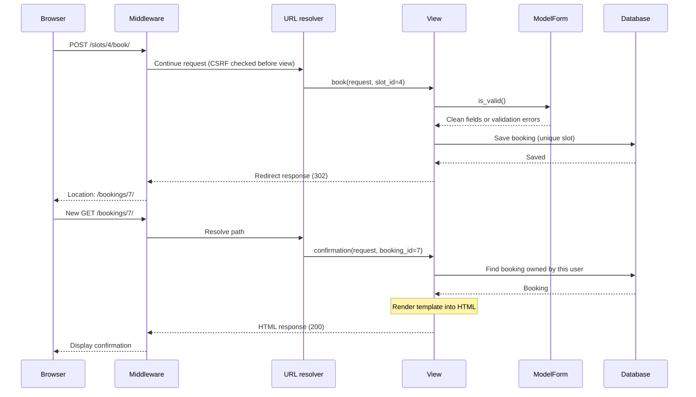

# Follow one appointment through Django

## Your first 10 minutes

1. Run the app. Sign in as `alex`.
2. Open `appointments/urls.py`. Find `slots/<int:slot_id>/book/`.
3. Open `appointments/views.py`. Find `def book`.
4. Book a time. Watch the terminal: POST returns 302, then GET returns 200.
5. Explain those two requests out loud before moving on.

## A map you can present

This is a conceptual map. Middleware wraps request handling; some middleware also
has view hooks. CSRF checks occur before the view runs. Middleware may return
an early response, so not every request reaches a view.

## Stop 1 · URL → view

File: `appointments/urls.py`.

Django matches the path and converts the slot ID to an integer. It passes that ID
and an `HttpRequest` into `book`. Query parameters don't change which URL route matches.

**Try:** open a nonexistent slot ID. Why does it return 404?

## Stop 2 · GET vs POST

File: `appointments/views.py`, function: `book`.

- GET opens an empty form. It changes nothing in the database.
- POST sends the input. `request.POST` holds submitted form fields.
- `request.user` comes from Django's authentication middleware.
- `login_required` redirects an anonymous visitor to login.

**Try:** open DevTools → Network. Compare the GET and POST entries.
Do not share captured session cookies or CSRF tokens in your presentation.

## Stop 3 · Form validation

File: `appointments/forms.py`.

A ModelForm reuses field rules from Booking. Both fields are required, whitespace
is stripped, and maximum lengths are checked. `is_valid()` checks input before saving.
Only attendee and purpose are editable. The view supplies the user and slot.

**Try:** submit a blank purpose. The browser may stop it first because it is required.
To see server validation, remove `required` in DevTools or read the validation test.
Invalid POST renders the form again with errors; it does not redirect or save.

## Stop 4 · Database rules

File: `appointments/models.py`.

Resource → many Slots. User → many Bookings. Slot → at most one Booking.
`OneToOneField` puts uniqueness in the database, not just the screen.

Two people can open the same available slot before either submits. The first save
wins. A duplicate insert raises `IntegrityError`; the view catches it outside the
atomic block and displays a friendly error. SQLite is for this small local demo;
real concurrent workloads need further database testing.

**Try:** open the same slot in two browsers, submit the first, then the second.

## Stop 5 · Response and redirect

File: `appointments/views.py`, functions: `book` and `confirmation`.

`redirect()` returns an HttpResponse with status 302 and a Location header.
The browser follows that URL with a new GET. `render()` loads a template, combines
it with context data, and returns an HTML HttpResponse.

**Try:** refresh the confirmation. Why isn't another appointment created?

## Stop 6 · Ownership and safe changes

The confirmation and cancellation queries include `user=request.user`.
Knowing somebody else's booking ID does not grant access. Staff can see the shared
overview; ordinary users cannot. Cancellation and logout use POST with CSRF tokens.

**Try:** sign in as `sam` and open Alex's confirmation URL. Expect 404.

## Stop 7 · Middleware

File: `appointments/middleware.py`.

`get_response(request)` is the boundary: code before it runs on the way in;
code after it sees the response on the way out. Request middleware runs in configured
order; the response travels back through those layers in reverse order.

The logger records real method, path, resolved view, status, and elapsed time.
It does not log attendee names, form bodies, passwords, or session cookies.
Set `TRACE_REQUESTS = False` to switch it off.

## Small exercises (one at a time)

1. Change the booking page's heading. Find its template first.
2. Add a help text to the purpose field. Check where it must be rendered.
3. Add an optional email field. Make a migration, update the form, then test it.
4. Explain why changing only the button cannot enforce permissions.
5. Design a cancellation history before adding a status column: how will the slot
   become bookable again while past bookings remain stored?

## Course connections

The [provided course](https://github.com/codesensei-courses/django-4-fundamentals)
progresses through project setup, pages, models, model/view/template integration,
URLs, styling, ModelForms, then editing and authentication.
Use this project's files as a second example of those concepts.
